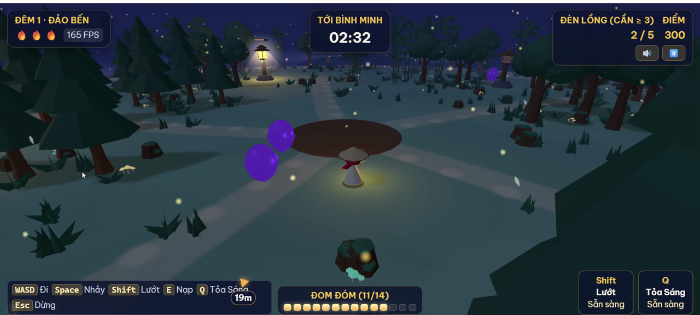
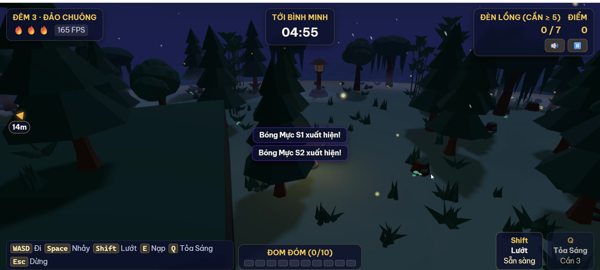

# Đảo Đèn Lồng — Day 12 AI SDLC Lab (v1.0.0)

> **Video Demo (< 5 phút · 04:41):** [Xem video demo (.mp4)](docs/demo/demo.mp4) · **Phát hành:** [GitHub Release v1.0.0](https://github.com/vukhanhkg2005-lang/K5-L3A-DAY12-NguyenVuKhanh-2A202603427-AI-SDLC-Dao-Den-Long/releases/tag/v1.0.0)  
> **Sinh viên:** Nguyễn Vũ Khanh (`2A202603427`) · **Lớp:** K5-L3A · **Contract:** `v1.3`

**Đảo Đèn Lồng** là game 3D góc nhìn thứ ba qua **3 Đêm (Đảo Bến, Đảo Cau, Đảo Chuông)**. Người chơi điều khiển **Mây** (đội nón lá treo đèn lồng nhỏ) gom đom đóm, thắp sáng và **châm dầu giữ đảo sáng tới bình minh** (`≥ 60%` số đèn sáng), đối phó **Bóng Mực** hút dầu, **Gió Lạc** cướp đom đóm và **Gió mạnh**.

### Ảnh chụp trong game



---

## 1. Yêu cầu hệ thống

- **Chơi game & Headless / Soak:** Node.js `>= 18` (chạy đồng nhất trên macOS, Linux, Windows) + trình duyệt hỗ trợ WebGL2.
- **Chạy 3D Benchmark (`bench_cmd`):** Đã cài Google Chrome, Chromium hoặc Microsoft Edge (hoặc thiết lập biến môi trường `CHROME_PATH`).
- **Tùy chọn Docker:** Có sẵn [Dockerfile](Dockerfile) nếu muốn chạy trong container.

---

## 2. Cài đặt & Chạy game (tối đa 3 lệnh)

```bash
npm ci
npm run build
npm start
```

Mở trình duyệt tại `http://localhost:4173` để chơi ngay (hỗ trợ đầy đủ **Bảng xếp hạng lưu cục bộ trên đĩa**).

*(Hoặc chạy bằng Docker: `docker build -t dao-den-long . && docker run -p 4173:4173 dao-den-long`)*

---

## 3. Điều khiển & Khả năng tiếp cận (Accessibility)

Tất cả 9 phím bên dưới đều có thể **đổi phím tự do** trong **Cài đặt & Tiếp cận** (có phát hiện trùng phím & nút **Khôi phục mặc định**, tự lưu `localStorage`):

| Hành động | Phím mặc định | Chức năng |
|---|---|---|
| Di chuyển | `W A S D` (hoặc mũi tên) | Chạy `6.0 m/s` (có Bùa Gió: `7.2 m/s`) |
| Nhảy | `Space` | Nhảy (`vy = 7.0 m/s`, khi chạm đất) |
| Lướt (Dash) | `Shift` | Lướt `14 m/s` trong `0.2 s`, hồi chiêu `1.5 s` (giữ độ cao trên không) |
| Tương tác | `E` | Nạp đom đóm (`10`), thắp lại (`5`) hoặc **Châm dầu** (`+10` fuel/đom đóm) |
| Tỏa Sáng (Pulse) | `Q` (hoặc `F`) | Tốn `3` đom đóm, hồi chiêu `3.0 s`, đẩy lùi `4 m` & choáng `2.0 s` (`+15` nếu đang `drain`) |
| Xoay camera 3D | `Kéo chuột` hoặc `J` / `L` | Độ nhạy chuột chỉnh trong Cài đặt |
| Tạm dừng | `Esc` (hoặc `P`) | Dừng hoàn toàn logic, mở Menu tạm dừng |
| Âm thanh nhanh | `M` | Bật / tắt âm thanh Web Audio API |

### Các tính năng Tiếp cận (Accessibility) tích hợp
- **Bảng màu dễ phân biệt (Mù màu):** Viền & mắt Bóng Mực đổi `#7A3CFF` → `#00B3FF`; cảnh báo UI đổi `#FF5A5F` → `#FFFFFF` kèm `⚠`. Đèn tắt luôn **xẹp 20%** và có **họa tiết vết rách giấy**; đèn yếu (`fuel < 30`) nhấp nháy `1 Hz`.
- **Phụ đề & chỉ báo hình ảnh:** Hiện phụ đề & **mũi tên ở mép màn hình** khi Bóng Mực xuất hiện; phụ đề khi gió sắp thổi, đếm ngược `10 s` cuối và khi đèn xuống `< 30%` dầu.
- **Giảm chuyển động:** Tắt rung camera, chớp màn hình và nhấp nháy.
- **Cỡ chữ UI:** Tối thiểu `18 px` ở `1280×720` + tùy chọn **Chữ lớn (`×1.25`)**.

---

## 4. Test Contract v1.3 — Kiểm thử, Headless, Benchmark, Soak & Bảng xếp hạng

### 4.1. Chạy toàn bộ Unit Tests & Headless Scenarios (Regression Phase 1–4)
```bash
npm test
```

### 4.2. Chế độ Headless CLI (Contract v1.2 / v1.3)
```bash
node src/headless.js --seed 2026 --night 3 --ticks 18000 --out out.jsonl --snapshot-every 10
```

### 4.3. Chế độ Benchmark 3D (`1280×720`, 200 Bóng Mực + 100 đom đóm)
```bash
node src/bench.js --seed 42 --duration 30 --out bench.json
```
- **VSync:** Đã tắt VSync qua cờ Chromium `--disable-frame-rate-limit --disable-gpu-vsync` (`vsync_off: true`).
- **Bộ nhớ (`peak_mem_mb`):** Trên bản web chạy trình duyệt đa tiến trình (Windows), ghi `null` khi không lấy được tổng RSS GPU+Renderer; trên Linux/macOS tự đo RSS của tiến trình chính nếu khả dụng.
- **Kết quả đo tham khảo (RTX 3050 Laptop / Windows 11, lưu tại [bench.json](bench.json)):** `avg_fps = 882.8`, `p1_low_fps = 368`, `frame_ms_p95 = 1.8 ms`, `frames = 26484`, `load_ms = 1524 ms` (vượt xa ngưỡng `avg ≥ 60`, `p1_low ≥ 30`, `load ≤ 10000`).

### 4.4. Soak Test 10 Đêm liên tiếp (Headless)
```bash
node --expose-gc src/soak.js --seed 7 --nights 10 --out soak.json
```
- **Kết quả đo thực tế (lưu tại [soak.json](soak.json)):** `nights = 10`, `crashes = 0`, `mem_start_mb = 47.43`, `mem_end_mb = 50.51` (`1.065× ≤ 1.2×`), `duration_s = 0.247 s`.

### 4.5. Xuất Bảng xếp hạng cục bộ (Top 10)
```bash
node src/run.js --export-leaderboard out.json
```
Dữ liệu bảng xếp hạng được lưu bền vững trên đĩa tại `~/.dao-den-long/leaderboard.json` (tên `3–12` ký tự `[A-Za-z0-9_]` + hỗ trợ tiếng Việt có dấu, sắp theo `score` giảm dần, bằng điểm xếp người đạt trước).

---

## 5. Sáng tạo của tôi (Tách biệt khỏi Headless & Tắt trong Benchmark/Soak)

Toàn bộ yếu tố sáng tạo nằm trong `src/render/` và UI, **tắt hoàn toàn trong chế độ headless và cảnh benchmark/soak**:
1. **Khu rừng đêm cổ tích đa tầng & Tối ưu `InstancedMesh` (`src/render/forest.js`, `src/render/scene.js`):**
   - **5 loại cây/thực vật low-poly procedural (121–142 cây + ~1.000 cụm tầng thấp mỗi Đêm, gom trong chỉ 16 draw calls `THREE.InstancedMesh`):** Cây Tùng/Thông đêm 4 tầng tán, Cây Cổ thụ thân nghiêng có cành phụ & tán nhiều khối, Khóm Tre/Trúc cổ tích có đốt & quạt lá (dày đặc ở Đảo Cau), Cây Liễu rủ sương đêm ven mép đảo, và tầng thấp gồm bụi dương xỉ, cỏ cao, gốc cây mục phủ rêu, cụm nấm phát sáng dịu và đá cuội.
   - **Chừa khoảng trống an toàn cho gameplay:** Tự động giữ trống bán kính `≥ 4.5 m` quanh Đèn Lồng, điểm xuất phát, bục nhảy, cầu tre Đêm 2, hai dốc & tầng đỉnh Tháp Chuông Đêm 3 và lối mòn đá lát.
   - **Gió thổi tán lá bằng GPU vertex sway (`onBeforeCompile`):** Tán cây, khóm tre và thảm cỏ đung đưa từng đợt theo hướng gió thực (tăng mạnh khi Đêm 3 nổi gió giật, đứng yên khi bật Giảm chuyển động).
2. **Hiệu ứng Bình minh 3D khi thắng màn & Nền 3D Màn hình chính (`src/render/scene.js`, `src/main.js`, `src/style.css`):**
   - **Bình minh 3D (`ShaderMaterial` Sky Dome + Mặt trời mọc):** Khi hoàn thành bất kỳ Đêm nào (`won`), vòm trời chuyển mượt từ đêm `#0E1430` sang rạng đông vàng cam, mặt trời & quầng hào quang nhô lên khỏi chân trời biển mây, trăng sao mờ dần, sương chuyển sắc ấm và ánh nắng rọi bóng đổ xuyên tán rừng.
   - **Màn hình chính lộ nền 3D trực tiếp:** Đảo Bến lên đèn rực rỡ, xoay camera toàn cảnh bên cạnh thẻ Menu kính mờ (`backdrop-filter` chỉ nằm gọn trong thẻ, giữ nguyên cỡ chữ tiếng Việt sắc nét bằng `Be Vietnam Pro`).
3. **Hiệu ứng không khí & phản hồi hành động VFX (`src/render/vfx.js`):**
   - **Ánh sáng xuyên tán & hào quang đèn:** Cột sáng hình nón (`Light Cone`) mềm rọi xuống mặt đất, quầng sáng thở theo nhịp lửa và hồ sáng dưới chân Đèn Lồng.
   - **Hạt rừng đêm & sương mặt đất:** `180` hạt bụi sáng vàng bay chậm, `100` chiếc lá rơi lất phất (cuốn nhanh theo hướng gió Đêm 3), `26` dải sương `#1B2350` trôi chậm ven rừng, vòm trời shader + trăng lưỡi liềm + 2 tầng biển mây `#12384A`.
   - **VFX hành động cho Mây:** Vệt hạt gió khi **Lướt (Dash)**, vòng sóng ánh sáng 2 tầng kèm `36` tia hạt bung tỏa khi **Tỏa Sáng (Pulse)**, và cột hạt ánh sáng bay xoắn ốc từ Mây vào lõi Đèn Lồng khi nạp/châm dầu/thắp sáng.
4. **Nhận diện đèn không cần màu & Âm thanh procedural (`src/render/audio.js`):** Đèn tắt xẹp 20% + vết rách giấy, đèn yếu nhấp nháy `1 Hz`; nhạc nền ngũ âm + đủ 10 SFX bằng Web Audio API thuần code.

---

## 6. Tài liệu SDLC, Bằng chứng & Báo cáo

- Contract v1.3: [game.contract.json](game.contract.json) · Kết quả đo: [bench.json](bench.json) · [soak.json](soak.json)
- Kiến trúc & Lịch sử thay đổi: [docs/adr/001-lantern-fuel-and-dawn-win.md](docs/adr/001-lantern-fuel-and-dawn-win.md) · [CHANGELOG.md](CHANGELOG.md)
- Báo cáo từng Phase & Retro tổng hợp: [docs/proof/phase-1/REPORT.md](docs/proof/phase-1/REPORT.md) · [docs/phase2-report.md](docs/phase2-report.md) · [docs/phase3-report.md](docs/phase3-report.md) · [docs/phase4-report.md](docs/phase4-report.md) · [docs/retro.md](docs/retro.md)
- Harness AI & Nhật ký: [AGENTS.md](AGENTS.md) · [.claude/skills/verify-phase/SKILL.md](.claude/skills/verify-phase/SKILL.md) · [.claude/settings.json](.claude/settings.json) · [.github/workflows/ci.yml](.github/workflows/ci.yml) · [docs/notes/ai-log.md](docs/notes/ai-log.md)
- Bản quyền & Tài liệu Lab: [CREDITS.md](CREDITS.md) · [LICENSE](LICENSE) · [GUIDE.md](GUIDE.md) · [CHECKPOINTS.md](CHECKPOINTS.md) · [SUBMISSION.md](SUBMISSION.md) · [RULES.md](RULES.md) · [RUBRIC.md](RUBRIC.md)
